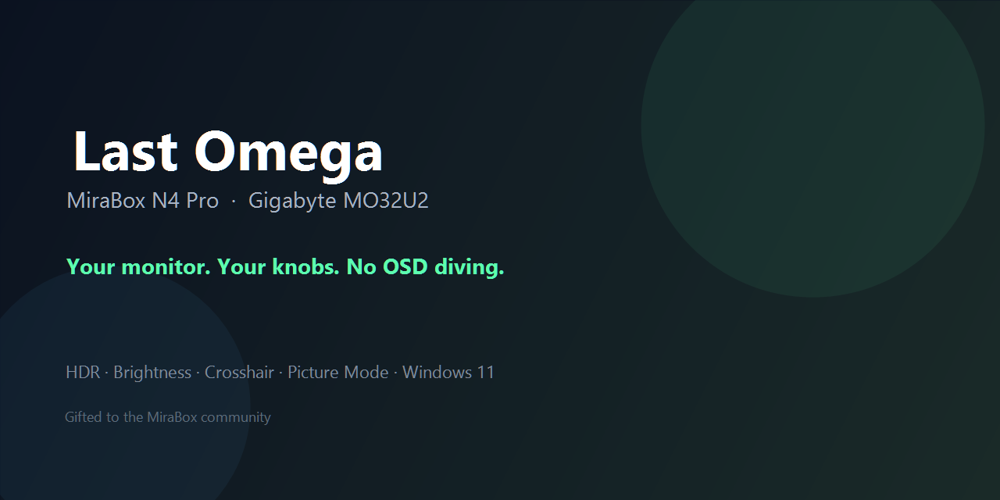
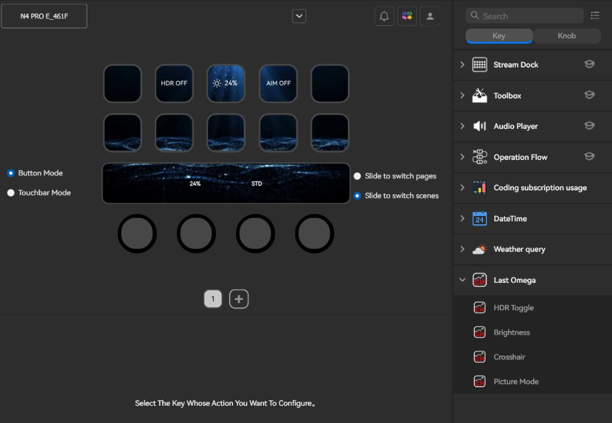
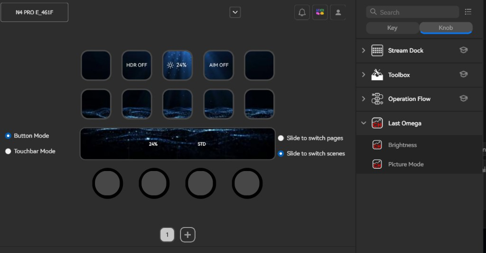
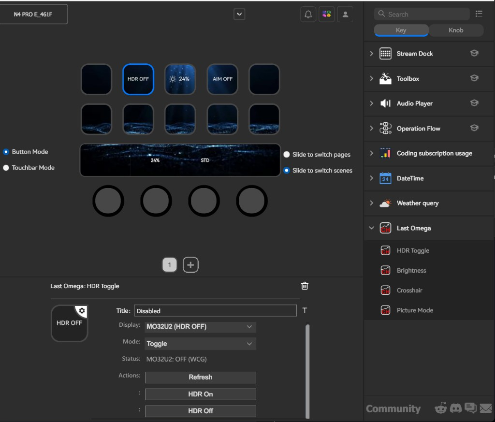

<p align="center">
  
</p>

<h1 align="center">Last Omega</h1>

<p align="center">
  <strong>Your MO32U2. Your knobs. No OSD diving.</strong><br/>
  A Stream Dock plugin for <strong>MiraBox N4 Pro</strong>, purpose-built for the
  <strong>Gigabyte MO32U2</strong> monitor —
  HDR, brightness, crosshair, picture modes and refresh rate without digging through the OSD.
</p>

<p align="center">
  <a href="#install"></a>
  <a href="docs/README.ru.md"></a>
  <a href="docs/README.zh-CN.md"></a>
  <a href="LICENSE"></a>
</p>

<p align="center">
  
  
  
  
  
  
</p>

> Built and validated on **MiraBox N4 Pro** + **Gigabyte MO32U2**.  
> Languages: **[English](README.md)** · **[Русский](docs/README.ru.md)** · **[中文](docs/README.zh-CN.md)**

**Credits:** directed & product owner — **R4444H**; implementation — **Cursor (AI coding assistant)**.  
**License:** [MIT](LICENSE) — free for everyone: use, share, fork, and modify however you like.

---

## Why this exists

The **Gigabyte MO32U2** is a serious gaming / creator panel. Its OSD is not.  
The **MiraBox N4 Pro** (Stream Dock) has real knobs and keys sitting on your desk.

**Last Omega** connects that exact pair: panel controls on the N4 Pro — no digging through the monitor menu.

| Action | What it does |
|--------|----------------|
| **HDR Toggle** | Flip Windows HDR for the MO32U2 |
| **Brightness** | Turn for monitor brightness **0–100** in SDR and HDR; press the key or dial to toggle HDR |
| **Crosshair** | On-panel AIM via Gigabyte Sidekick HID, with a verified DDC fallback on MO32U2 |
| **Picture Mode** | Cycle **Graphics** profiles (STD / FPS / MOBA / …) with preview-then-apply |
| **Refresh Rate** | Show current panel Hz on a Key (`240Hz`), configurable poll interval |

Keep your aim, keep your hands on the dials, keep the monitor menu closed.

---

## Gallery

<p align="center">
  
  
  
</p>

---

## Requirements

| Item | Version / note |
|------|----------------|
| **OS** | **Windows 11 only** (not tested / not supported on Windows 10) |
| **Host device** | **MiraBox N4 Pro** (Stream Dock) — primary; other Stream Dock devices with Keys/Knobs may work |
| **Host app** | Stream Dock desktop **≥ 3.10.188.226** |
| **Plugin runtime** | **Node.js 20** (bundled with Stream Dock as `node20`) |
| **Monitor** | **Gigabyte MO32U2** — primary validated display |
| **Sidekick** | Gigabyte Control Center / OSD Sidekick (crosshair + picture mode) |
| **PowerShell** | 5.1+ (ships with Windows 11) |

> Packaged releases already include `node_modules` (`ws`). End users do **not** need to install Node separately.

### Hardware this project is for

| Piece | Model | Role |
|-------|--------|------|
| Controller | **MiraBox N4 Pro** | Keys + Knobs (Brightness & Picture Mode shine on dials) |
| Display | **Gigabyte MO32U2** | HDR, DDC brightness, Sidekick HID crosshair & Graphics modes, refresh rate |

---

## Install

See also the full guide: **[docs/INSTALL.md](docs/INSTALL.md)** ([RU](docs/INSTALL.ru.md) · [中文](docs/INSTALL.zh-CN.md))

### Option A — Download the install package (recommended)

1. Open **[Releases](../../releases/latest)** and download  
   `LastOmega-<version>-windows.zip`
2. Quit Stream Dock
3. Unpack so you get a folder named  
   `com.mirabox.streamdock.lastomega.sdPlugin`
4. Copy that folder into:

```text
%APPDATA%\HotSpot\StreamDock\plugins\
```

5. Start Stream Dock → category **Last Omega**

Or from PowerShell (after downloading the zip):

```powershell
Expand-Archive .\LastOmega-0.5.5-windows.zip -DestinationPath "$env:TEMP\lastomega"
Copy-Item "$env:TEMP\lastomega\com.mirabox.streamdock.lastomega.sdPlugin" `
  "$env:APPDATA\HotSpot\StreamDock\plugins\" -Recurse -Force
```

### Option B — One-shot install from a release asset

```powershell
# From a cloned repo, after you placed the zip under dist\
.\scripts\install-release.ps1 -ZipPath .\dist\LastOmega-0.5.5-windows.zip
```

### Option C — Build from source

See [Build](#build) below, then `.\scripts\deploy.ps1`.

---

## Build

```powershell
# 1) Dependencies (Node 20+)
cd com.mirabox.streamdock.lastomega.sdPlugin\plugin
npm ci
cd ..\..

# 2) Dev deploy (preserves monitor state and restarts Stream Dock)
.\scripts\deploy.ps1

# 3) Create the community install zip → dist\
.\scripts\pack.ps1
```

### Stack

| Layer | Tech |
|-------|------|
| Plugin host API | Stream Dock SDK (`ws` WebSocket, Node 20) |
| Monitor session | One Windows PowerShell process, serialized local JSON over stdin/stdout |
| HDR | Windows DisplayConfig |
| Brightness | DDC/CI monitor brightness in SDR and HDR |
| Crosshair / Picture | Gigabyte OSD Sidekick USB HID (`VID_0BDA&PID_1100`); AIM also supports MO32U2 DDC `0xEF` |
| Refresh Rate | DisplayConfig path refresh (Hz), snapped to common panel rates |
| UI | Transparent keys + dial titles; Property Inspectors (HTML) |

`MonitorControl.ps1` reuses the maintained diagnostic helpers in one Windows
PowerShell session. Their Win32 interop types load once per session through
the existing `Add-Type` calls. There is no custom EXE, MSBuild step, download,
or compilation on each poll. The process uses `RemoteSigned`; system execution
policy, Group Policy and antivirus settings are not changed. After a display
mode change, the session reconnects to release stale driver state.

Controls share status reads per monitor. Brightness is checked every 15 seconds
by default, HDR and picture metadata every 30 seconds, refresh rate every 60
seconds. Windows display events and user input refresh the affected controls
immediately. AIM has no recurring poll. Only visible controls keep a poll active;
failures use bounded backoff. Hardware writes have priority over queued reads.
Brightness changes preview immediately and are combined into one write after
280 ms without rotation. Picture mode selection is remembered from the last
successful plugin command; changes made directly in Sidekick are not reliably
readable through the panel's remapped VCP `0x14`.

Measured on MO32U2 + N4 Pro on 2026-10-25, with the device's working profiles and
32 logical processors (60-second idle samples; plugin and its descendants,
excluding the Stream Dock host): average CPU fell from 2.524% to 0.014%, peak
working memory from 489.5 to 167.8 MB. After initialization, the new sample
contained no PowerShell starts or compiler processes, versus 117 of each
previously. These are measurements on the validation PC, not an FPS benchmark.
The original profile had a separate HDR key; the new profile uses the brightness
control to toggle HDR.

---

## Repository layout

```text
last-omega/
├── README.md / docs/          # EN + RU + ZH
├── assets/                    # Banner + screenshots
├── scripts/
│   ├── deploy.ps1             # Dev install
│   ├── pack.ps1               # Release zip for MiraBox users
│   └── install-release.ps1    # Install from zip
├── tools/probes/              # Hardware experiments (not shipped)
├── .github/workflows/         # Release packaging CI
└── com.mirabox.streamdock.lastomega.sdPlugin/
    ├── manifest.json          # v0.5.5 · Node 20
    ├── en.json / ru.json / zh_CN.json
    ├── plugin/                # index.js + persistent session + diagnostic helpers + ws
    ├── propertyInspector/     # Per-action settings
    └── static/
```

---

## Compatibility

| Works today | Notes |
|-------------|--------|
| **MiraBox N4 Pro** | Primary device — validated with Keys + Knobs |
| **Gigabyte MO32U2** | Primary monitor — validated end-to-end |
| Windows **11** | Required |
| Stream Dock host **≥ 3.10.188.226** | Desktop app that drives the N4 Pro |

Other Stream Dock / MiraBox units with Knobs may run the same plugin.  
Other Gigabyte Sidekick panels may work partially — open an issue with your model + VCP/HID notes.

---

## Contributing & license

- Guide: [`CONTRIBUTING.md`](CONTRIBUTING.md)
- Security: [`SECURITY.md`](SECURITY.md)
- License: [`MIT`](LICENSE) — **free for everyone**. You may use, copy, modify, merge, publish, and distribute this plugin (including commercial forks) with almost no restrictions — just keep the copyright notice.

### Credits

| Role | Who |
|------|-----|
| Direction, product decisions, testing on **N4 Pro + MO32U2** | **R4444H** |
| Implementation (code, docs, packaging) | **Cursor AI**, under R4444H’s guidance |

Released under the **[MIT License](LICENSE)** — you may use, copy, modify, merge, publish, distribute, sublicense, and/or sell copies of this software.
